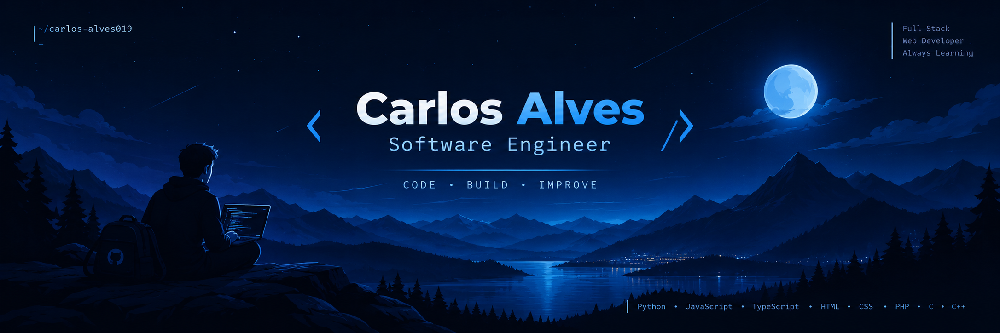

 

**Estudante de Gestão e Programação de Sistemas Informáticos (GPSI)**

*Famalicão, Portugal · Desenvolvimento de Software e Web*

 

 

---

## &lt;/&gt; Sobre mim

Sou o **Carlos Alves**, estudante do curso de **Gestão e Programação de Sistemas Informáticos (GPSI)** na **OFICINA — Escola Profissional**, em Portugal.

Tenho um grande interesse em **desenvolvimento de software** e **desenvolvimento web**. Gosto de explorar novas tecnologias, resolver problemas e transformar conhecimentos em projetos práticos.

Considero-me uma pessoa dedicada, organizada, pontual e responsável. Valorizo o trabalho em equipa, a aprendizagem contínua e a capacidade de enfrentar novos desafios.

> **O meu objetivo:** evoluir como programador, desenvolver soluções úteis e construir uma carreira na área da tecnologia.

---

## &lt;/&gt; Tecnologias

---

## &lt;/&gt; Ferramentas e plataformas

---

## &lt;/&gt; Experiência

### SETUP TECH — Formação em Contexto de Trabalho

**Março – Abril de 2026 | 140 horas**

Experiência prática na área do desenvolvimento web, com foco em:

- Desenvolvimento frontend utilizando **HTML, CSS, JavaScript e Bootstrap**.
- Criação e personalização de projetos em **WordPress**.
- Colaboração em projetos internos da empresa.
- Desenvolvimento de competências técnicas e de trabalho em equipa.

---

## &lt;/&gt; Certificações

### Discover — Rocketseat

Formação em fundamentos de programação web, incluindo:

**HTML · CSS · JavaScript · Git · GitHub**

---

## &lt;/&gt; Idiomas

| Competência | Português | Inglês |
|:--|:--:|:--:|
| Compreensão | C2 | B1 |
| Leitura | C2 | B2 |
| Escrita | C2 | A2 |
| Fala | C2 | B1 |

---

## &lt;/&gt; Projetos e atividade

 

---

  

### &lt;/&gt; Sempre a aprender e a evoluir

**Estudante de GPSI · Desenvolvimento de Software**

 

